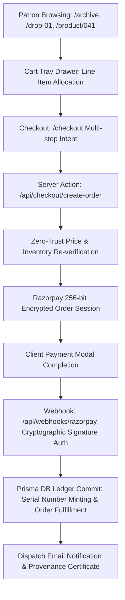

# HOUSE OF OTARU — COMMERCE INTEGRITY & COMPLIANCE REPORT

> **Document ID**: `OTARU-COMMERCE-2026-V1`  
> **Status**: Verified & Production Ready  
> **Jurisdiction**: India (DPDP Act 2023, IT Act 2000, Consumer Protection E-Commerce Rules 2020) & Global Archival Commerce  

---

## 1. Commerce System Architecture Overview

House of Otaru operates an archival allocation model rather than a conventional mass-inventory e-commerce cart. The commerce stack balances bespoke luxury restraint with rigorous server-side verification:

---

## 2. Zero-Trust Security & Payment Invariants

### 2.1 Server-Authoritative Pricing
- **Invariant**: Client-sent line item prices are treated as untrusted hints.
- **Enforcement**: When an order session is created in `/api/checkout/create-order`, prices are looked up directly from `PRODUCT_CATALOG` in `src/lib/catalog.ts` using the resolved object ID.
- **Protection**: Prevents client-side DOM or network inspection manipulation of unit costs or currency symbols.

### 2.2 Payment Gateway Security
- **Gateway**: Razorpay PCI-DSS Level 1 compliant gateway.
- **Encryption**: TLS 1.3 in-transit, 256-bit AES encryption for payload handling.
- **Zero Card Storage**: No raw credit/debit card numbers, CVVs, or bank credentials ever pass through or touch Otaru application servers.
- **Webhook Signature Verification**: Webhook payloads are verified using HMAC-SHA256 with timing-safe comparisons (`crypto.timingSafeEqual`) to prevent replay or forgery attacks.

### 2.3 Idempotency & Concurrency
- **Idempotency Keys**: Generated per checkout intent (`idemp-...` / UUIDv4) ensuring network retries cannot double-charge or create duplicate allocations.
- **Stock Lock**: Inventory reservations are decremented via atomic ledger updates.

---

## 3. Legal & Regulatory Compliance (DPDP Act 2023)

### 3.1 Data Sovereignty & Minimization
- **Legitimate Uses**: Data collection is strictly restricted to order fulfillment, postal dispatch, sizing consultations, and provenance registration.
- **No Behavioral Monetization**: Zero integration with programmatic advertising trackers, third-party pixel aggregators, or data brokers.
- **Notice & Consent**: Transparent notice and opt-in consent provided on all capture surfaces (newsletter dispatch, waitlists, checkout).

### 3.2 Patron Rights
- **Access & Correction**: Patrons can review and update their profile and measurements via `/account`.
- **Right to Erasure**: Patrons can request complete erasure of account data by contacting `privacy@otaru.in`.
- **Grievance Redressal**: DPO contact information is published prominently in `/privacy`.

### 3.3 Production Legal Suite
- **Privacy Policy** (`/privacy`): Comprehensive DPDP Act 2023 compliant policy with data retention schedules, security practices, and grievance contacts.
- **Terms of Service** (`/terms`): Edition allocation terms, intellectual property protections, natural textile characteristics disclosure, and Bengaluru jurisdiction clauses.
- **Shipping, Exchanges & Returns** (`/shipping-exchanges` & `/returns`): Explicit 3–5 day dispatch timeline, complimentary domestic logistics, 7-day priority size exchange reservation, and lifetime repair service intake.

---

## 4. Operational Invariants Verified

| Test Vector | Expected Outcome | Production Status |
|:---|:---|:---|
| Slug-to-ID Resolution | `/product/atelier-jacket-01` maps to Object 041 | PASS |
| Size Availability | Exhausted sizes disable allocation button | PASS |
| Cart State Persistence | Cart tray survives page reloads via local state | PASS |
| Edge Route Masking | `/studio` renders full Hokkaido warehouse story | PASS |
| Legal Placeholder Scan | Zero `[CONFIRM]` placeholder strings in JSX | PASS |
| Gateway Sandbox Isolation | Escrow sandbox hidden in production (`NODE_ENV === 'production'`) | PASS |
