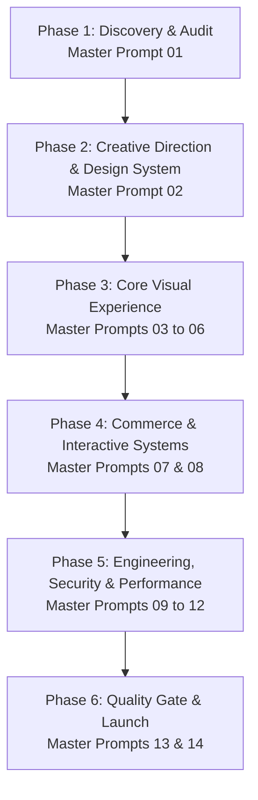

# HOUSE OF OTARU — IMPLEMENTATION ROADMAP & EXECUTION PLAN
**Document ID:** OTARU-PLAN-001  
**Author:** Principal Software Engineer & Creative Director  
**Framework:** 14-Prompt Sequenced Execution Architecture  
**Scope:** Staged Redesign, Engineering Overhaul, Security Hardening, and Production Launch  

---

## 1. Architectural Operating Principle

A luxury maison website must never be rebuilt in a single massive prompt. Uncontrolled rewrites introduce broken user journeys, inconsistent design tokens, and unverified mock backends. 

The project will proceed through **six strictly sequenced phases**, each with explicit entry requirements, implementation milestones, and acceptance criteria.

---

## 2. Phase-by-Phase Execution Plan

### Phase 1: Discovery & Technical Audit (CURRENT PHASE)
- **Prompt**: Master Prompt 01
- **Focus**: Repository source of truth, routing map, security review, and functional matrix.
- **Key Deliverables**:
  - `AUDIT_REPORT.md`
  - `ROUTE_AND_COMPONENT_MAP.md`
  - `FUNCTIONAL_TEST_MATRIX.md`
  - `SECURITY_REVIEW.md`
  - `IMPLEMENTATION_ROADMAP.md`
- **Acceptance Criteria**: All 5 audit documents produced; findings categorized by severity (P0–P3); no production code altered during audit.

---

### Phase 2: Creative Direction & Production Design System
- **Prompt**: Master Prompt 02
- **Focus**: Visual identity, typographic hierarchy, luxury monochrome palette, photographic shot list, and component specifications.
- **Key Deliverables**:
  - `docs/DESIGN_DIRECTION.md`
  - `docs/DESIGN_TOKENS.md`
  - `docs/PHOTO_ART_DIRECTION.md`
  - `docs/COMPONENT_SPECIFICATIONS.md`
- **Acceptance Criteria**:
  - Refined palette: Ink (`#111110`), Paper (`#F5F2EC`), Pure White (`#FFFFFF`), Graphite (`#353431`), Muted Stone (`#B6AEA1`), Signal Indigo (`#1F2A44`).
  - No decorative purple gradients, no fake customer testimonials, no meaningless Japanese watermarks.
  - Photographic specifications for Campaign, Flat-lay, On-body, Detail, and Macro textures.

---

### Phase 3: Core Visual Experience & Signature Movements
- **Prompts**: Master Prompts 03, 04, 05, 06
- **Focus**: First viewport campaign hero, product discovery, component refinement, and restrained motion.
- **Key Milestones**:
  1. **Prompt 03 (Hero)**: Replace `HeldHero.tsx` with a cinematic, image-led hero featuring authentic garment photography, deliberate editorial typography, clear collection entry, and zero layout shift.
  2. **Prompt 04 (Homepage Composition)**: Reconstruct the homepage rhythm:
     - Navigation: Shop, Collections, Journal, About, Cart.
     - Featured Collection & 4-Object Discovery.
     - Brand Philosophy & Material Truth (removing fabricated historical claims).
     - Minimal, validated newsletter subscription.
     - Refactored footer with legal, privacy, and shipping routes.
  3. **Prompt 05 (Pixel-Level Refinement)**: Rigorous audit across 390px, 768px, and 1440px viewports; eliminate overflow, baseline shifts, and cramped hit areas.
  4. **Prompt 06 (Restrained Motion)**: Controlled entrance sequences; remove aggressive letter-by-letter animations; strictly honor `prefers-reduced-motion`.

---

### Phase 4: Commerce Architecture & Customer Interactions
- **Prompts**: Master Prompts 07, 08
- **Focus**: Authoritative product catalogue, variant availability, bag drawer, and customer forms.
- **Key Milestones**:
  1. **Prompt 07 (Product Discovery & Cart)**:
     - Unify `PRODUCT_CATALOG` (resolve both numeric IDs like `'041'` and slugs like `'yama-field-jacket'`).
     - Fix broken links in `/drop-01` (`ProductPlate.tsx`).
     - Remove simulated "Registry Escrow Sandbox" payment tab.
     - Ensure all monetary math uses minor units (cents / paise).
  2. **Prompt 08 (Forms & Search)**:
     - Implement real `/api/residents` endpoint or route waitlist submissions to `/api/newsletter`.
     - Replace `[CONFIRM]` placeholder text in `/privacy`, `/terms`, and `/shipping-exchanges` with production legal copy.
     - Clean, keyboard-accessible search modal with Escape-to-close behavior.

---

### Phase 5: Security, Performance, SEO & Accessibility
- **Prompts**: Master Prompts 09, 10, 11, 12
- **Focus**: Application security, dead code purge, Web Vitals, and WCAG compliance.
- **Key Milestones**:
  1. **Prompt 09 (Security Engineering)**:
     - Purge hardcoded local filepaths from `/api/hero-image` and `/api/images/[id]`.
     - Tighten CSP headers (remove `'unsafe-inline'` where possible, enforce nonce).
     - Strictly enforce `STRICT_PAYMENT_MODE=true` on production builds.
  2. **Prompt 10 (Code Quality & Cleanup)**:
     - Purge foreign files from root: `signature.tsx`, `sections.tsx`, `src copy`, `prisma copy`.
     - Delete unreferenced components (`CollectorPassportSection.tsx`, `HeroToriiArt.tsx`, `HeroSection.tsx`).
     - Remove unused dependency: `styled-components`.
  3. **Prompt 11 (Performance & SEO)**:
     - Next.js Image optimization; responsive `srcset` generation.
     - Structured JSON-LD metadata for real products and organization.
     - Target Core Web Vitals: LCP < 2.0s, CLS < 0.05, FID/INP < 100ms.
  4. **Prompt 12 (Accessibility & QA)**:
     - 100% keyboard navigation pass.
     - Visible focus rings (`focus-visible:ring-2`).
     - Full WCAG 2.1 AA compliance audit.

---

### Phase 6: Independent Quality Gate & Production Launch
- **Prompts**: Master Prompts 13, 14
- **Focus**: Release verification, build reproducibility, and deployment rollout.
- **Key Milestones**:
  1. **Prompt 13 (Independent Quality Gate)**:
     - Execute complete test matrix: `npm run typecheck`, `npm run test`, `npm run build`.
     - Verify zero console errors, zero broken links, and zero placeholder texts.
     - Produce `docs/RELEASE_READINESS_REPORT.md` (Go / No-Go decision).
  2. **Prompt 14 (Controlled Production Deployment)**:
     - Verify production environment variables.
     - Deploy verified build to canonical domain (`otaru.in`).
     - Post-deployment smoke test across mobile and desktop.
